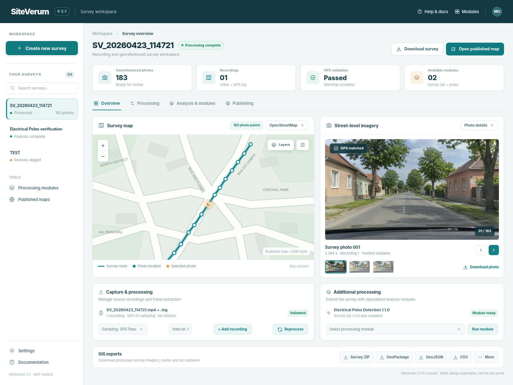

# SiteVerum

**Turn road survey videos and GPS tracks into interactive maps, georeferenced photos, and GIS-ready exports.**

Capture on Android → Upload → Validate → Process → Explore → Export.



*SiteVerum 2.1 interface concept illustrating a survey workspace.*

SiteVerum is an **open-source, self-hosted street-imagery workflow** for road surveys, infrastructure documentation, project planning, and construction supervision. Survey data stays in your own Docker installation unless you deliberately expose a published map or share exports. This project is not affiliated with Google Street View.

**[Try the interactive demo](https://markfishurupa-dot.github.io/streetview-v2/demo/)** · **[Read the documentation](https://markfishurupa-dot.github.io/streetview-v2/)** · **[Process your first survey](https://markfishurupa-dot.github.io/streetview-v2/guide/first-survey/)**

The demo is read-only. To upload videos and run processing, install the portal locally.

## What you can do

- **Capture on Android:** Record MP4 video and a GPS log, then share the matching files individually or together as a ZIP.
- **Import and validate:** Upload a ZIP or separate MP4/LOG files; inspect media integrity and GPS quality warnings.
- **Process:** Extract photos by GPS fix, time, or distance; preserve the video-to-location relationship.
- **Review and correct:** Navigate route photographs, adjust point coordinates and bearings, rotate images, and remove unwanted photo points.
- **Export:** Download photographs and GIS data including GeoPackage, GeoJSON, CSV, and a portable survey ZIP.
- **Publish a read-only map:** Select route/photo layers and control whether the published view requires administrator authentication.

Multiple recordings can be combined into one survey while retaining separate route segments. The portal uses FastAPI, a background worker, and PostGIS with persistent Docker volumes.

## Install the portal

**Tested deployment target:** Linux `amd64` containers through Docker Desktop. The project currently supports **one administrator and one processing worker**. A clean native-Linux installation and full backup/restore remain release verification items.

You need Git and Docker Desktop running **Linux containers** on Windows. From PowerShell:

```powershell
git clone https://github.com/markfishurupa-dot/streetview-v2.git
cd streetview-v2
.\setup.ps1
```

Open **http://127.0.0.1:18080/**. Sign in as `admin` using the `SV_ADMIN_PASSWORD` generated in your local, untracked `deploy/.env` file. Keep this file private and preserve it across restarts.

On Linux, the repository also includes `bash ./setup.sh`; native-Linux clean-install validation is still pending.

**[Full Windows/Linux installation guide](https://markfishurupa-dot.github.io/streetview-v2/start/install/)** includes troubleshooting, storage, and stop/restart instructions. The default installation binds to the host loopback interface, not the public Internet.

## Processing modules

SiteVerum 2.1 adds installable ZIP modules, survey quality reports and map review for detection results. The module-enabled Windows setup uses port 18090. See the [illustrated module guides](https://markfishurupa-dot.github.io/streetview-v2/modules/), [operator guide](docs/modular-processing.md) and [module contract](docs/contracts/streetview-module-api-v1.md).

## Capture and process your first survey

1. **Android app.** Follow the [Android capture guide](https://markfishurupa-dot.github.io/streetview-v2/start/android/). [Download the signed SiteVerum Android 1.3.1 APK](https://github.com/markfishurupa-dot/streetview-v2/releases/download/v2.1.0/SiteVerum-1.3.1.apk) or browse the [Android source](apps/android).
2. **Record and transfer:** Capture a survey and share its ZIP, or the matching MP4 and LOG with identical basenames.
3. **Create and upload:** In the portal, create a survey, then upload the source files. The two files can also be uploaded at different times.
4. **Validate and process:** Review the GPS report; choose GPS-fix, time, or distance sampling; start processing.
5. **Explore and export:** Navigate georeferenced photos, correct points if necessary, and download `survey.zip` or individual GIS files.
6. **Publish optionally:** A published map is read-only. **Publicly available** means anyone who can reach your server can view the selected publication without signing in; it does *not* automatically expose localhost to the Internet.

Follow the [illustrated first-survey walkthrough](https://markfishurupa-dot.github.io/streetview-v2/guide/first-survey/) for the full process.

## Documentation and project status

| Resource | Purpose |
| --- | --- |
| [Live demo](https://markfishurupa-dot.github.io/streetview-v2/demo/) | Explore a sample route and photos without installation |
| [Installation](https://markfishurupa-dot.github.io/streetview-v2/start/install/) | Windows, Linux, credentials, Docker troubleshooting |
| [SiteVerum 2.1 release](https://github.com/markfishurupa-dot/streetview-v2/releases/tag/v2.1.0) | Portal source, module downloads, and the signed Android APK |
| [Android guide](https://markfishurupa-dot.github.io/streetview-v2/start/android/) | Install, record and export a survey |
| [Publishing](https://markfishurupa-dot.github.io/streetview-v2/guide/publishing/) | Read-only access, authentication, and network exposure |
| [Development guide](https://markfishurupa-dot.github.io/streetview-v2/reference/development/) | Local tests, API and architecture |
| [Release checklist](docs/public-release-checklist.md) | Verified features and remaining acceptance items |

The project owner tested the survey workflow in two field tests covering six survey sessions. For installation support or custom development, contact [Mark Urupa](https://www.linkedin.com/in/mark-urupa/).

**Privacy:** Survey photographs and GPS tracks can contain personal and sensitive location information. Obtain appropriate permission before recording and sharing. The [public demo dataset](site/public/demo/DATASET_LICENSE.md) has separate data-use terms from the software license.

## Project history and compatibility

**SiteVerum was previously known as StreetView v2.0.** Renamed in November 2026 to establish an independent identity while preserving existing surveys, the `SV_` recording prefix, `SV_*` environment variables, database structure, API contracts and Android application identifier. Historical release `v2.0.0-alpha.6` retains its original APK filename, `StreetView.apk`; it is not a newly branded binary. Existing installations can continue using their original Docker volumes and configuration. See [the rebranding migration guide](docs/siteverum-rebranding.md).

## Contribute and license

See [CONTRIBUTING.md](CONTRIBUTING.md), [SECURITY.md](SECURITY.md), and [THIRD_PARTY_NOTICES.md](THIRD_PARTY_NOTICES.md).

Copyright © 2026 Mark Urupa. SiteVerum source is licensed under **[GNU AGPL-3.0-only](LICENSE)**. Third-party libraries, container components, and survey imagery retain their own terms.
