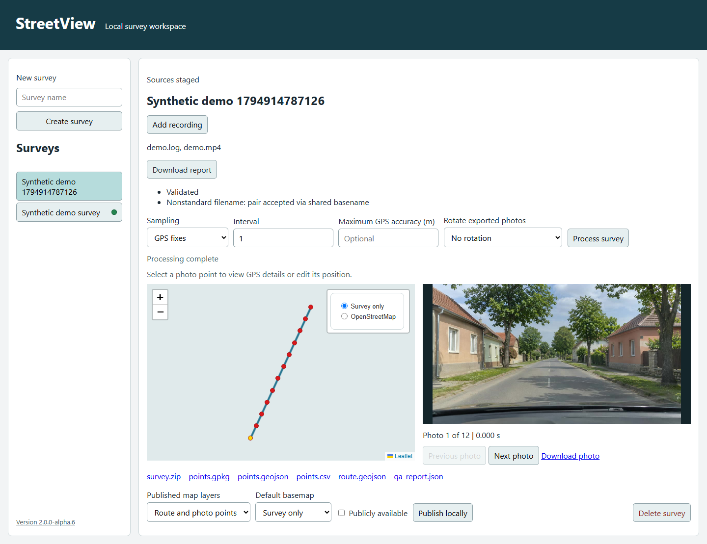

# StreetView 2.0

**Turn road survey videos into interactive maps.**

Capture on Android → Upload → Process → Explore → Export



*The workspace above uses synthetic coordinates and a generated street image.*

Create self-hosted surveys from video and GPS, review photos on a map, correct positions and bearings, and export GIS layers. Published maps can be restricted to the administrator or made available to visitors who can reach your server.

- [Installation and user guide](site/src/content/docs/start/install.md)
- [Visual survey tutorial](site/src/content/docs/guide/workflow.md)
- [Android capture app](apps/android/README.md)
- [Interactive demo](https://markfishurupa-dot.github.io/streetview-v2/demo/)
- [Contributing](CONTRIBUTING.md) · [Security](SECURITY.md) · [License](LICENSE)

To preview the documentation and demo locally, install Node.js 24, run `npm ci --prefix site` followed by `npm run dev --prefix site`, and open the local address printed by Astro.

To review the real survey on this workstation, run `npm run preview:real --prefix site`. It uses the processed survey stored in `private-samples/real-demo` and opens the documentation and demo on port 4326. This command rebuilds the local preview with the real photo sequence and OpenStreetMap selected.

Turn road survey video and GPS tracks into georeferenced photographs, GIS layers, and a map you can explore. StreetView is a self-hosted alpha designed by Mark Urupa and licensed under AGPL-3.0-only.

Record on Android, export the recording, upload it to the portal, validate and process it, then review the map or export the results for GIS software. The portal supports multiple recordings, photo rotation, point corrections, route and photo layers, and read-only published survey maps.

The Android capture source is in [apps/android](apps/android). The verified portal deployment target is Docker Desktop with Linux amd64 containers. Android builds and public distribution are still being verified. The application currently supports one administrator and one processing worker.

## Install and use the portal

Run from this checkout in PowerShell with Docker Desktop using Linux containers. On a new checkout, create the local configuration once.

```powershell
python -c "import secrets; from pathlib import Path; p=Path('deploy/.env'); f=p.open('x'); f.write('SV_DB_PASSWORD='+secrets.token_urlsafe(24)+'\nSV_ADMIN_PASSWORD='+secrets.token_urlsafe(24)+'\n'); f.close()"
docker compose -f deploy/compose.yaml up -d --build --wait
```

Open [StreetView on port 18080](http://127.0.0.1:18080/). Sign in as `admin` with `SV_ADMIN_PASSWORD` from `deploy/.env`. To use another port, set `SV_PORT` in that file. Preserve the database password across restarts.

1. Create a survey and upload an Android ZIP or the matching MP4 and LOG. You can upload the two files at different times.
2. Set an optional GPS accuracy limit, then select **Validate sources**. After validation, use **Download report** to get the detailed report and excluded GPS records as CSVs in one ZIP.
3. Select **GPS fixes** to reproduce the sample run, or choose time or distance and set the interval. During processing, the progress bar and cancel control appear beside the settings.
4. Select **Process survey**. When processing completes, select a map arrow or use **Previous photo** and **Next photo**. Download GIS layers individually or use `survey.zip` for relative image paths and QA files.
5. Choose **Published map layers** (route, photo points, or both) and a **Default basemap** (Survey only or OpenStreetMap). Enable **Publicly available** to let anyone who can reach the server open the published map without signing in. The default requires admin sign-in. Choose **Publish locally**, then use **Open published map** to open the read-only map at the survey name URL. On an existing publication, use **Update published map** or **Republish map** to apply changes. Unpublishing revokes that URL. The map stays on its published run until you republish. A green dot marks a current publication; a yellow dot means the workspace has newer data or results. Restarting the stack preserves surveys, jobs and artifacts. **Delete survey** hides it and revokes access through this application. It retains original assets for the alpha.

Public availability applies to the selected layers and photos on that map URL. The workspace and its downloads still require admin sign-in. The default Compose binding is `127.0.0.1`; visitors on other devices need a network route to the app, such as a reverse proxy on the host.

To extend an existing survey, open it and choose **Add recording**. Upload another ZIP or its matching MP4 and LOG, then validate and process. Every recording keeps its own video timeline. The combined map shows separate route segments, and each photo in the combined GIS package has a unique relative path. The workspace keeps the previous completed run available while processing.

Select the version in the sidebar to open **About StreetView**.

The workspace map starts on an offline backdrop. Published maps open with the saved basemap, and visitors can switch using the Layers control. OpenStreetMap requests tiles for the geographic area in view. Photo locations appear as dots below zoom 19 and as directional arrows in the viewport at higher zoom, where a bearing is available.

Select **Rotate exported photos** and process again to bake the rotation into all JPEGs in a new run. To correct a GPS position, select a photo point in the workspace map, open **Edit**, then drag its handle, type coordinates, or change the bearing. To remove the point and its photo from the current revision, select **Delete point** and confirm. The route connects the neighboring points within the same recording. The new revision uses the same photos and updates the selected point, corresponding route segment, and GIS exports. The published map remains view-only and displays the corrected revision after you republish. Reprocessing applies saved corrections to matching source observations. Processing uses one worker. The Linux amd64 deployment is the test target. See [status](docs/status.md) for acceptance evidence.

```powershell
docker compose -f deploy/compose.yaml restart
docker compose -f deploy/compose.yaml ps
python -m unittest discover -s tests -v
```

For the private browser test, install Playwright and Pyogrio in your test environment, make Edge available, set `STREETVIEW_SAMPLE_ZIP` to the original two-file ZIP, and run `python tests/compose_acceptance.py`. The browser tests use the local credentials and remove temporary surveys from the catalog when finished. The recording acceptance test covers multiple recordings, publication layers and About.

## License

Copyright 2026 Mark Urupa. StreetView source is licensed under the [GNU Affero General Public License version 3 only](LICENSE). Preserve copyright and license notices when redistributing. Modified versions used over a network must offer their corresponding source to users under the license terms. Commercial use and sale are permitted under those terms. Third-party components have their own licenses, as described in [third-party notices](THIRD_PARTY_NOTICES.md).
