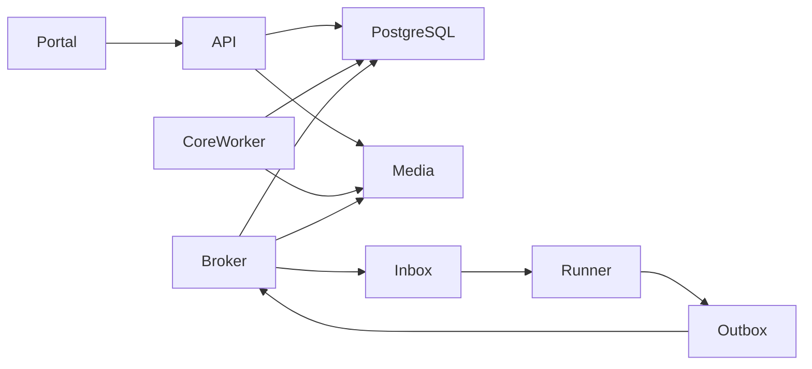

# Modular processing

SiteVerum administrators can install trusted modules, run them against processed surveys, and review and export results. See the [illustrated guides](https://markfishurupa-dot.github.io/streetview-v2/modules/) for module workflows and authoring steps.

## Start the isolated Windows environment

Run from the feature checkout in PowerShell with Docker Desktop running in Linux-container mode.

```powershell
python modules/build_packages.py
pwsh -NoProfile -File ./start-modules-dev.ps1 -Ml
```

Open http://127.0.0.1:18090 and sign in as `admin`. The script writes a random password to the `SV_ADMIN_PASSWORD` entry in `deploy/.env.modules-dev`. Keep that file private. Use **Log out** in the header to end the browser session. Use `-Port` before first startup to choose a different free port. For subsequent startups, the script reads the saved port.

The Compose project is `streetview-v2-modules-dev`. Its database, media, runner inbox and runner outbox use project-scoped volumes. The existing `setup.ps1` continues to use its own setup and Compose project. Start without `-Ml` for dependency-free Python modules. Start with `-Gpu` to request NVIDIA GPU access through Docker Desktop and WSL2. Startup falls back to the CPU setup if Docker cannot expose an NVIDIA adapter or launch the GPU service. Each detection job also probes CUDA with a real tensor operation and can retry on CPU if GPU inference raises a supported runtime error.

## Install a module

1. Open **Modules** in the workspace sidebar.
2. Select a ZIP you trust and choose **Install ZIP**.
3. Open **Package details** to inspect the package checksum, inputs, outputs, runtime and model information.
4. Use **Disable** to prevent new executions of that version. A version with execution history remains available for review or export. An unused version can be removed.

Uploading the same archive again returns the existing version. If the package has changed, increment its version before installing it. Package identity includes the SHA-256 of its ZIP bytes.

### Electrical poles

Download the [Electrical Poles Detection 1.1.0 package](https://github.com/markfishurupa-dot/streetview-v2/releases/download/v2.1.0/streetview-poles-detection-1.1.0.zip) and the [default YOLO11s pole checkpoint](https://github.com/markfishurupa-dot/streetview-v2/releases/download/v2.1.0/pole_yolo11s_best.pt). Put the checkpoint in the provisioned model directory. Replace `C:\path\to` with the directory containing your download.

```powershell
New-Item -ItemType Directory -Force -Path deploy/module-models | Out-Null
Copy-Item -LiteralPath 'C:\path\to\pole_yolo11s_best.pt' -Destination deploy/module-models/
Get-FileHash -LiteralPath deploy/module-models/pole_yolo11s_best.pt -Algorithm SHA256
```

Expected SHA-256 is `80f281ec613757df2934b258afa9b578ae074af16e7393b87cd2a1b33e283cb6`. The module ZIP contains the processing source. See the [model card](models/pole-yolo11s.md) for provenance, licensing and training settings.

Install `streetview-poles-detection-1.1.0.zip` through **Modules → Install ZIP**. Process a survey, select **Electrical Poles Detection** under **Additional Processing**, choose the parameters, and click **Run module**. The run has its own progress, cancellation and logs. If cache-compatible detection results exist for the same source run, the new execution can reuse pixel-space detections while recomputing geometry. Moving a survey point creates a new source processing run and invalidates that detection cache.

The four classes are concrete, generic, metal and wood. A fixed forward-facing camera uses GPS travel bearing as a heading approximation. The camera offset is clockwise, defaulting to 0 degrees. Linear projection preserves the standalone 70-degree field-of-view approximation. Rectilinear projection uses `atan(2 * (x / width - 0.5) * tan(HFOV / 2))`. Extraction applies image rotation before the module receives pixels. Inconsistent rotation or a misaligned mount can bias position estimates.

The algorithm preserves buffered ray pairs, minimum observation baseline and angular separation, roadside filtering, DBSCAN clustering, and station and lateral deduplication. Each recording is processed independently. A single pole seen in separate recordings may appear more than once. Roadside snapping defaults to 12 m for compatibility and can be disabled. The raw and initial display coordinates are both retained. Neighboring poles can be suppressed by the default 22 m station threshold. Use the audit CSV to inspect this decision and lower the thresholds when needed.

A detection confidence describes model output. Supporting frame count, pair angular separation, ray residuals and GPS quality describe the geometry inputs. Positions are estimates.

### Review and export

Open a completed run and use **Show layer on map**. Select a pole marker to open its evidence and review form. The legend identifies class by color and letter. Use the class, review state and confidence filters; execution history is scoped to the displayed survey. The ray overlay loads on request and is bounded by its file size. Larger ray layers can be downloaded.

Approve or reject a pole, edit its coordinates numerically, or drag its map handle and save the review. **Reset location** restores the initial displayed estimate, including the configured snap if enabled. The raw triangulated coordinates and previous reviews remain in history. For runs against the displayed survey version, **Go to survey photo** opens the same frame in the survey view. For a historical run, the evidence panel opens the authenticated historical image.

Download reviewed results as GeoJSON, CSV or GeoPackage. **Export approved only** filters all three formats. **Execution files** contains immutable original job files. These retain the initial model estimates and diagnostics.

| Execution file | Contents |
| --- | --- |
| `poles.geojson`, `poles.csv`, `poles.gpkg` | Initial estimated locations and feature properties |
| `pole_detections.csv` | Raw inference boxes in pixel coordinates before class and shape filtering |
| `pole_rays.geojson` | Observation rays transformed to WGS84 longitude/latitude |
| `pole_evidence.json` | Source frame mapping, confidence and normalized detection boxes |
| `intersections_all.csv`, `intersections_roadside.csv` | Buffered intersections before and after roadside cuts, in each recording's metric CRS |
| `clustered.csv`, `dedupe_audit.csv` | Cluster candidates, retained poles and duplicate associations |
| `qa_summary.json`, `result.json` | Counts, warnings, layer declarations and file checksums |

### Custom models and manual poles

With Electrical Poles Detection 1.1.0, use **Add model** to upload a trusted Ultralytics detection checkpoint (`.pt`). Select it in **YOLO model** before running. To use different checkpoint labels, supply a mapping such as `{"utility_pole":"pole_generic"}` during upload. The four supported pole classes work automatically. Unmapped labels outside those classes are skipped. Each run records the selected checkpoint and keeps its own results.

In **Open results**, select **Add Pole**. Pick a location on the map or enter coordinates, select a pole class, and choose **Save pole**. Manual poles can be moved or reviewed like detected poles. They appear in the approved export. Temporary additions stay in the current tab and can be saved with **Download GeoJSON**.

### Temporary map review

Vector modules default to **Keep results temporary** in the portal. After a run finishes, open its results and select **Add temporary layer to map** to inspect the features. You can review individual features and move a point using the same map tools. Temporary features, summaries, and output files are held on disk for 24 hours. PostgreSQL tracks the job status. Review edits stay in the browser tab and are cleared on reload or when the tab closes.

Use **Download GeoJSON** to retain your changes, including approved-only results. The original execution files are also downloadable during the 24-hour window. Clear **Keep results temporary** before running when you need to retain a review history or publish a layer.

### Survey QA

Install `dist/streetview-survey-qa-1.0.0.zip` and choose **Survey QA** in the same processing panel. Its report counts frames and missing bearings and can include counts by recording. It uses only Python's standard library.

## Publication and private imagery

Public and authenticated published maps use the survey's existing slug and published core run. Ordinary module layers are opt-in. Under **Publication privacy and module layers**, select completed layers from the current core processing run. Publishing saves a copy of the approved features with the module's allowlisted scalar public properties. Future reviews and executions do not change the saved map until the administrator republishes. Original images, boxes, and evidence routes stay in the authenticated workspace.

To require redaction, install a trusted `pre_publication` module and save it as the survey's photo privacy policy. This immediately blocks image access through published URLs until the administrator publishes using a compatible completed derivative run. Publication requires a validated derivative for each source frame. Missing files, a stale source job, failed runs, or incomplete derivative mappings never cause published media to fall back to source images. Survey bundles containing original photographs are inaccessible through published routes while the policy applies. Administrators still use the authenticated workspace to review original surveyed frames.

The privacy contract supports separately stored JPEGs, input image mappings, redaction metadata and optional verification reports. A checkpoint or package checksum verifies bytes. The administrator must trust the module and verify that its algorithm meets the intended redaction policy. The acceptance fixture replaces every pixel with black. A production face or plate detector is outside this implementation.

## Storage and operations



Migration `008.sql` adds version, queue, feature, review, artifact, evidence and derivative tables and publication snapshot references. It preserves existing IDs and publication slugs. Status progresses through queued, running, completed, failed or cancelled. A completed run is marked previous when its core source changes or a newer execution for that module completes. Restarted workers fail interrupted work safely and allow an administrator to retry. Only validated outputs in the completed state appear in result endpoints.

The broker uses an isolated volume for staged input and a second volume for output. The runner has no network, database credentials, survey storage, or Docker socket. Its root filesystem and staged inputs are mounted read-only. Linux Landlock ABI 3 restricts the child to the current package and inputs, reviewed runtime resources, and designated work directories. The Compose runner limits CPU, RAM, process count and temporary storage. Time, upload, archive expansion, frame count and output size have explicit limits. Module output is still executable-derived and requires trusted provenance. Install only reviewed packages and PyTorch checkpoints.

Before upgrading an existing environment, pause incoming changes, stop its API and workers, and back up both PostgreSQL and the named media volume. Use `pg_dump -Fc` against the running database service, and copy the binary dump out with `docker cp`. Archive the media volume from a temporary container with a read-only source mount and a writable local backup mount. Preserve the environment configuration and any separately provisioned models. Test the backup in an isolated project by restoring into an empty database with `pg_restore` and extracting the media archive into an empty volume. Never share database or media volumes across development and existing deployments.

## Troubleshooting

- **Missing model or checksum mismatch**. Check the name and SHA-256 above and ensure the file is under `deploy/module-models`.
- **ML runtime unavailable**. Restart the isolated app with `-Ml`.
- **CUDA unavailable**. Verify NVIDIA drivers, WSL2 and a Docker GPU probe. The CPU path works without CUDA.
- **No detected features**. This can be a successful result. Inspect the report for missing bearings, rejected geometry, the selected class, and whether there are multiple suitable observations.
- **Publication blocked**. Run the required derivative module against the current core processing run and review its artifact mappings.
- **Module failed after restart**. Inspect the execution log, correct any configuration or dependency issue, and run it again.

See [the developer contract](contracts/streetview-module-api-v1.md) for package authoring and endpoint details and [the verification report](modular-processing-verification.md) for executed checks.
